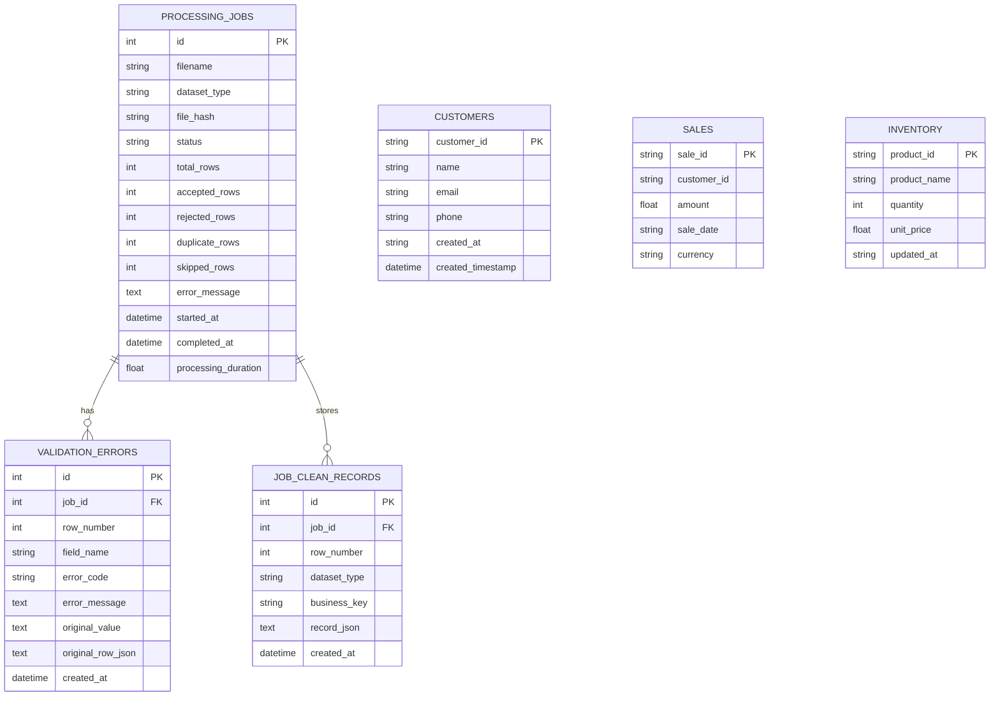

# Edvexa Data Quality & ETL Monitor

> **Subtitle:** Reliable Data. Clean Pipelines. Trusted Decisions.  
> **Author:** Raghav Kumar | Software Engineer  
> **Platform Version:** 2.6.0  
> **Technology Stack:** Python 3.11+, FastAPI, SQLAlchemy 2.x, Pydantic, Pandas, SQLite / PostgreSQL, Vanilla JS, Chart.js

---

## 1. Project Overview

**Edvexa Data Quality & ETL Monitor** is a production-grade, locally runnable web application and data quality observability engine designed to ingest, validate, sanitize, and load operational CSV datasets (Customers, Sales, and Inventory).

It guarantees strict data integrity before raw records can enter downstream clean storage tables. Every ingested row is accounted for deterministically under the fundamental invariant:

$$\text{total\_rows} = \text{accepted\_rows} + \text{rejected\_rows} + \text{duplicate\_rows} + \text{skipped\_rows}$$

The application provides:
- **Resilient CSV Ingestion:** Automatic charset detection (UTF-8, UTF-8 BOM, Latin-1), schema enforcement, and 10 MB upload guardrails.
- **Granular Field Validation:** Standardized email validation, calendar date verification, whitespace stripping, title capitalization, numeric bounds checking, and supported currency enforcement.
- **Idempotency & Duplicate Prevention:** SHA-256 file checksum tracking, in-file duplicate detection, and database unique key constraints that prevent double-insertion on repeated uploads.
- **Interactive Visual Dashboard:** Real-time KPI summary cards, historical ingestion quality trend charts (Chart.js), dataset breakdowns, paginated job history, validation error reports, and a clean records browser.
- **Interactive OpenAPI Documentation:** Fully typed Swagger UI (`/docs`) and ReDoc (`/redoc`) endpoints.
- **Export & Download Engine:** Direct job-scoped downloads for Clean Records (CSV), Validation Errors (CSV), and comprehensive Job Audit Workbooks (Excel `.xlsx`).
- **Administrative Destructive Reset:** iPhone-style compact slide-to-reset with concurrency-locked transactional data deletion (`POST /api/dashboard/reset-data`) clearing uploaded records while strictly preserving database schema, with idempotent empty-state handling (`HTTP 200`).
- **End-to-End Date Range Filtering:** Synchronized date filtering across dashboard summary, trends, jobs, clean records, and validation errors with strict empty-state displays.
- **Dynamic Real-Event Notifications:** Event-driven notification store tracking uploads, exports, reprocessing, and reset actions with unread badge count and individual item dismissal.
- **Dual Aesthetic Themes & WCAG AA Contrast:** Warm beige & ivory default theme and dark espresso mode with audited 4.5:1 text contrast across all form controls, drop zones, and data tables.
- **Automated Test Suite:** 65 comprehensive unit, integration, ETL, reset, date-filtering, and API tests executed via `pytest`.

---

## 2. System Architecture

```
edvexa-data-quality/
│
├── app/
│   ├── __init__.py
│   ├── main.py                     # FastAPI application factory, middleware, lifecycle & routing
│   ├── config.py                   # Pydantic & environment configuration settings
│   ├── database.py                 # SQLAlchemy engine, session maker & schema initialization
│   ├── models.py                   # SQLAlchemy 2.x models (ProcessingJob, ValidationError, Clean Tables)
│   ├── schemas.py                  # Pydantic v2 validation models & response serialization
│   ├── services/
│   │   ├── __init__.py
│   │   ├── csv_import.py           # Robust file parsing, header verification & charset decoding
│   │   ├── transformation.py       # Deterministic cleaning, casing, date & numeric parsers
│   │   ├── validation.py           # Schema rules, email regex, bounds checks & error generation
│   │   └── etl_pipeline.py         # Atomic ETL execution, transaction management & idempotency
│   ├── routers/
│   │   ├── __init__.py
│   │   ├── uploads.py              # POST /api/uploads multipart CSV endpoint
│   │   ├── jobs.py                 # GET /api/jobs, GET /api/jobs/{id}, POST /api/jobs/{id}/reprocess
│   │   ├── errors.py               # GET /api/jobs/{id}/errors, GET /api/errors
│   │   ├── records.py              # GET /api/records (Customers, Sales, Inventory)
│   │   └── dashboard.py            # GET /api/dashboard/summary, GET /api/dashboard/trends
│   ├── templates/
│   │   └── index.html              # Responsive SPA layout (Sidebar, Overview, Ingestion, Browser)
│   └── static/
│       ├── css/
│       │   └── styles.css          # Navy typography, light backgrounds, restrained blue accents
│       └── js/
│           ├── app.js              # SPA navigation, modal dialogs, health polling & toast alerts
│           └── dashboard.js        # Chart.js charts, filters, upload drag-and-drop & tables
│
├── tests/
│   ├── __init__.py
│   ├── conftest.py                 # Test fixtures, in-memory SQLite isolation & TestClient
│   ├── test_transformation.py      # Tests for cleaners, string normalizers & date/numeric parsers
│   ├── test_validation.py          # Field validation rules, regex, bounds & CSV structural tests
│   ├── test_etl.py                 # ETL load, duplicate detection, accounting rule & idempotency
│   ├── test_api.py                 # Health, upload, jobs, errors, records, dashboard & downloads
│   ├── test_dashboard_upgrade.py   # Preference resets & dashboard date-range filtering tests
│   └── test_reset_and_filter.py    # Destructive reset safety, concurrency lock, OpenAPI, idempotency & joins
│
├── sample_data/
│   ├── customers_valid.csv         # 5 clean valid customer records
│   ├── customers_invalid.csv       # 7 invalid records (bad email, invalid dates, missing required fields)
│   ├── customers_duplicates.csv    # 2 records with duplicate customer_id CUST-001
│   ├── sales_valid.csv             # 5 clean valid sales transactions
│   ├── sales_invalid.csv           # 6 invalid sales (negative amounts, non-numeric, unsupported currency)
│   ├── inventory_valid.csv         # 5 clean valid inventory items
│   ├── inventory_invalid.csv       # 6 invalid inventory items (negative stock/price, fractional quantities)
│   ├── customers.csv               # 13 comprehensive mixed records
│   ├── sales.csv                   # 12 comprehensive mixed records
│   └── inventory.csv               # 12 comprehensive mixed records
│
├── demo/
│   ├── README.md                   # Video metadata & scenario walkthrough notes
│   └── edvexa-demo.mp4             # 4m23s full demonstration video (local file, excluded from Git)
│
├── screenshots/
│   ├── 01_dashboard_overview_light.png   # Full light theme overview (KPIs, donut, trends, recent jobs)
│   ├── 02_dashboard_overview_dark.png    # Full dark espresso theme overview (WCAG AA compliant)
│   ├── 03_import_data_workflow.png       # CSV drag-and-drop upload zone, dataset schema selector
│   ├── 04_processing_jobs_audit.png      # Processing jobs history table, status badges, durations
│   ├── 05_slide_to_reset_modal.png       # iPhone-style compact slide-to-reset & confirmation modal
│   └── 06_mobile_responsive_view.png     # Mobile viewport rendering (375x812 iPhone view)
│
├── scripts/
│   ├── generate_sample_data.py     # Deterministic sample dataset generator
│   ├── generate_pdf.py             # Script to render publication-grade TECHNICAL_NOTES.pdf
│   └── verify_e2e.py               # Automated 9-step end-to-end API verification script
│
├── schema.sql                      # Standalone ANSI SQL DDL schema definitions & indexes
├── requirements.txt                # Pinned dependencies
├── .env.example                    # Non-secret environment defaults
├── .gitignore                      # Git exclusions (venv, databases, caches, logs)
├── README.md                       # Comprehensive operational guide
├── TECHNICAL_NOTES.md              # Engineering decisions, trade-offs & development notes
├── TECHNICAL_NOTES.pdf             # Formatted, printable technical documentation (PDF)
└── DEMO_CHECKLIST.md               # 13-step verification walkthrough
```

---

## Technical Documentation

Detailed engineering architecture notes, data models, trade-offs, and tooling demarcations are published in both Markdown and printable PDF formats:

- 📄 [Read Technical Notes (Markdown)](TECHNICAL_NOTES.md)
- 📑 [Download Technical Notes (PDF)](TECHNICAL_NOTES.pdf)

---

## 3. Prerequisites

- **Operating System:** Windows 10/11, macOS, or Linux.
- **Python:** Python 3.11, 3.12, or newer.
- **Git:** Installed and available on system PATH.
- **Modern Web Browser:** Chrome, Edge, Firefox, or Safari with JavaScript enabled.

---

## 4. Local Setup & Installation (Windows PowerShell / Command Prompt)

### Step 1: Clone or Navigate to the Workspace
```powershell
cd c:\Users\rjha1\Downloads\csv_project
```

### Step 2: Create an Isolated Virtual Environment
```powershell
python -m venv .venv
```

### Step 3: Activate the Virtual Environment
- **PowerShell:**
  ```powershell
  .\.venv\Scripts\Activate.ps1
  ```
- **Command Prompt (`cmd.exe`):**
  ```cmd
  .venv\Scripts\activate.bat
  ```

### Step 4: Upgrade Pip & Install Dependencies
```powershell
python -m pip install --upgrade pip
pip install -r requirements.txt
```

### Step 5: Configure Environment Variables (Optional)
Copy `.env.example` to `.env`:
```powershell
Copy-Item .env.example .env
```
*(By default, the platform runs using a local SQLite file database `edvexa_data.db`. PostgreSQL connection strings are fully supported via the `DATABASE_URL` setting).*

### Step 6: Database Initialization (Automatic or Manual DDL)
The platform initializes all required tables, constraints, and indexes automatically on application boot via SQLAlchemy (`init_db()` in `app/database.py`).

For external database inspection or standalone deployment, an ANSI SQL DDL script is provided in the repository root as `schema.sql`:
```powershell
# Optional manual initialization / inspection with SQLite CLI:
sqlite3 edvexa_data.db ".read schema.sql"
```

---

## 5. Application Startup & Browser Access

### Start the Application Server
Run Uvicorn from the project root:
```powershell
uvicorn app.main:app --host 127.0.0.1 --port 8010 --reload
```
*Or double-click `start_server.bat` on Windows for one-click startup.*

Upon startup, the application initializes the SQLite database schema automatically.

### Access Endpoints
- **Primary Dashboard UI:** [http://127.0.0.1:8010](http://127.0.0.1:8010)
- **Interactive Swagger API Docs:** [http://127.0.0.1:8010/docs](http://127.0.0.1:8010/docs)
- **ReDoc Technical Schema:** [http://127.0.0.1:8010/redoc](http://127.0.0.1:8010/redoc)
- **Health Verification:** [http://127.0.0.1:8010/api/health](http://127.0.0.1:8010/api/health)

---

## 6. Sample Datasets & Ingestion Instructions

Synthetic test datasets are located in `sample_data/`. You can regenerate all files deterministically at any time:
```powershell
python scripts\generate_sample_data.py
```

### Catalog of Sample Datasets

| Filename | Dataset Type | Records | Purpose & Scenarios Tested |
| :--- | :--- | :--- | :--- |
| `customers_valid.csv` | Customers | 5 | 100% clean records with whitespace normalization, email lowercasing, and date parsing. |
| `customers_invalid.csv` | Customers | 7 | Invalid email addresses (`plainaddress`, missing `@`), missing required fields, non-leap year Feb 29 dates (`2023-02-29`), and unparseable strings. |
| `customers_duplicates.csv` | Customers | 2 | Duplicate in-file business primary key (`CUST-001`). Row 1 is accepted, Row 2 is flagged as duplicate. |
| `sales_valid.csv` | Sales | 5 | 100% clean sales transactions with valid amounts, dates, and ISO currency codes (`USD, EUR, GBP, JPY`). |
| `sales_invalid.csv` | Sales | 6 | Prohibited negative amounts (`-150.00`), non-numeric amounts, unsupported currencies (`BITCOIN`), missing IDs, and invalid calendar dates. |
| `inventory_valid.csv` | Inventory | 5 | 100% clean products with valid integer quantities and unit prices. |
| `inventory_invalid.csv` | Inventory | 6 | Prohibited negative quantities (`-5`), negative prices, fractional box counts (`12.75`), missing product names, and invalid date strings. |
| `customers.csv` | Customers | 13 | Comprehensive mixed dataset containing clean records, normalization checks, duplicate keys, and invalid values in a single file. |
| `sales.csv` | Sales | 12 | Comprehensive mixed sales dataset with negative amounts, invalid currency, and date boundary checks. |
| `inventory.csv` | Inventory | 12 | Comprehensive mixed inventory dataset testing negative stock, decimal quantities, and blank names. |

### Ingestion via Web Interface:
1. Open [http://127.0.0.1:8010](http://127.0.0.1:8010) in your browser.
2. Click **Import Data** in the left sidebar navigation.
3. Select **Customers** in the dataset dropdown.
4. Drag and drop `sample_data/customers_valid.csv` (or click to browse).
5. Click **Run Ingestion Pipeline**. The UI immediately displays 5 accepted records.
6. Now upload `sample_data/customers_invalid.csv`: The UI displays 7 rejected records with detailed line-by-line validation diagnostics.
7. Upload `sample_data/customers_duplicates.csv`: Row 1 is accepted, Row 2 is reported as `DUPLICATE_KEY_IN_FILE`.
8. Re-upload `sample_data/customers_valid.csv` to demonstrate **Database Idempotency**:
   - 0 clean records inserted, 5 duplicate keys detected (`DUPLICATE_KEY_IN_DB`), 0 rejected, database clean tables remain untouched.

---

## 7. Export & Download Job Artifacts

The platform provides dedicated, job-scoped export capabilities for every processing run. Users can download artifacts directly after uploading via the ingestion feedback card, or anytime from the **Job Details** modal.

### Available Download Actions & Endpoints

| Endpoint | Method | Output Format | Description |
| :--- | :--- | :--- | :--- |
| `/api/jobs/{id}/download/clean` | `GET` | CSV (`text/csv`) | Exports only clean, normalized records accepted in this specific job with exact dataset column names. Returns `HTTP 400` if 0 rows accepted. |
| `/api/jobs/{id}/download/errors` | `GET` | CSV (`text/csv`) | Exports all validation errors recorded for this job (`job_id, row_number, dataset_type, field_name, error_code, error_message, original_value`). Returns `HTTP 400` if 0 errors. |
| `/api/jobs/{id}/download/summary` | `GET` | Excel (`application/vnd.openxmlformats-officedocument.spreadsheetml.sheet`) | Exports a multi-sheet Microsoft Excel workbook (`job_<id>_report.xlsx`) containing Job Summary, Clean Records, and Validation Errors. |

### UI Behavior & Features
- **Clean Records (CSV):** Disabled with a tooltip (`No clean records were accepted from this job`) if accepted rows equal 0.
- **Validation Errors (CSV):** Disabled with a tooltip (`No validation errors were recorded for this job`) if the run had zero validation errors.
- **Download Excel Report (.xlsx):** Always available for completed jobs, even if clean records or validation errors are empty.
- **Double-Click Prevention:** Download buttons enter a loading state during export and re-enable upon file delivery.

### Excel Report Structure (`job_<id>_report.xlsx`)
The exported workbook contains three formatted worksheets:
1. **`Job Summary`:**
   - **Execution Metadata:** Job ID, original filename, dataset type, status, SHA-256 checksum, timestamps, and duration.
   - **Pipeline Metrics:** Total rows, accepted records, rejections, duplicate keys prevented, skipped rows, validation error count, and data quality pass rate.
   - **Accounting Reconciliation Audit:** Verifies $\text{total\_rows} = \text{accepted} + \text{rejected} + \text{duplicates} + \text{skipped}$. Displays sum of categories, difference, and reconciliation status (`PASSED`).
2. **`Clean Records`:**
   - Contains only the normalized records accepted by the specific job.
   - Dataset columns (`customers`, `sales`, `inventory`) with frozen header row (`A2`), auto-filters, and formatted numbers/currencies.
   - If 0 clean records were accepted, displays an explanatory notice.
3. **`Validation Errors`:**
   - Itemizes all errors: `job_id, row_number, dataset_type, field_name, error_code, error_message, original_value`.
   - Frozen header row (`A2`), auto-filters, and wrapped error descriptions.
   - If clean run (0 errors), displays an explanatory notice.

---

## 8. Data Validation & Business Rules

| Dataset | Field | Type / Requirement | Normalization Applied | Rejection Error Code |
| :--- | :--- | :--- | :--- | :--- |
| **Customers** | `customer_id` | Required string | Trimmed | `MISSING_REQUIRED_FIELD` |
| | `name` | Required string | Trimmed, internal spaces collapsed, Title Case | `MISSING_REQUIRED_FIELD` |
| | `email` | Required RFC 5322 pattern | Trimmed, Lowercase | `MISSING_REQUIRED_FIELD`, `INVALID_EMAIL_FORMAT` |
| | `phone` | Optional string | Trimmed | N/A |
| | `created_at` | Required calendar date | Normalized to ISO `YYYY-MM-DD` | `MISSING_REQUIRED_FIELD`, `INVALID_DATE_FORMAT` |
| **Sales** | `sale_id` | Required unique PK | Trimmed | `MISSING_REQUIRED_FIELD` |
| | `customer_id` | Required foreign ref | Trimmed | `MISSING_REQUIRED_FIELD` |
| | `amount` | Required numeric $\ge 0.0$ | Parsed float, rounded to 2 decimals | `MISSING_REQUIRED_FIELD`, `INVALID_NUMERIC_VALUE`, `NEGATIVE_VALUE` |
| | `sale_date` | Required calendar date | Normalized to ISO `YYYY-MM-DD` | `MISSING_REQUIRED_FIELD`, `INVALID_DATE_FORMAT` |
| | `currency` | Required supported ISO code | Trimmed, Uppercase (`USD, EUR, GBP, CAD, AUD, JPY, INR`) | `MISSING_REQUIRED_FIELD`, `INVALID_CURRENCY` |
| **Inventory** | `product_id` | Required unique PK | Trimmed | `MISSING_REQUIRED_FIELD` |
| | `product_name`| Required string | Trimmed, Title Case | `MISSING_REQUIRED_FIELD` |
| | `quantity` | Required integer $\ge 0$ | Parsed integer | `MISSING_REQUIRED_FIELD`, `INVALID_NUMERIC_VALUE`, `NEGATIVE_VALUE` |
| | `unit_price` | Required numeric $\ge 0.0$ | Parsed float, rounded to 2 decimals | `MISSING_REQUIRED_FIELD`, `INVALID_NUMERIC_VALUE`, `NEGATIVE_VALUE` |
| | `updated_at` | Required calendar date | Normalized to ISO `YYYY-MM-DD` | `MISSING_REQUIRED_FIELD`, `INVALID_DATE_FORMAT` |

---

## 9. Duplicate Handling & Idempotency Policy

1. **In-File Duplicates:** If a primary business key (`customer_id`, `sale_id`, or `product_id`) appears more than once within the same uploaded file, the first valid occurrence is accepted, and all subsequent occurrences are classified as `duplicate_rows` with error code `DUPLICATE_KEY_IN_FILE`.
2. **Database Duplicates:** If an uploaded record contains a primary key that already exists in the clean database table, it is classified as `duplicate_rows` with error code `DUPLICATE_KEY_IN_DB`.
3. **Repeated File Uploads:** Uploaded raw bytes are hashed via SHA-256 and matched against previous runs. The repeated run is recorded in `processing_jobs` for audit transparency, but clean records are never double-inserted or overwritten.
4. **Mutual Exclusion Accounting:**
   $$\text{total\_rows} = \text{accepted\_rows} + \text{rejected\_rows} + \text{duplicate\_rows} + \text{skipped\_rows}$$
   Every row belongs to exactly one category.

---

## 10. REST API Endpoints & `curl` Request Examples

All endpoints return standard JSON responses and status codes. Interactive Swagger API documentation is available at [http://127.0.0.1:8010/docs](http://127.0.0.1:8010/docs).

### 10.1 System Health
```powershell
curl.exe -s http://127.0.0.1:8010/api/health
```
**Response:**
```json
{
  "status": "healthy",
  "version": "2.6.0",
  "database_connected": true,
  "timestamp": "2026-10-25T14:41:23.000000Z"
}
```

### 10.2 Ingest CSV Dataset
```powershell
curl.exe -X POST "http://127.0.0.1:8010/api/uploads?dataset_type=customers" `
  -F "file=@sample_data/customers_valid.csv"
```
**Response:**
```json
{
  "job_id": 8,
  "filename": "customers_valid.csv",
  "dataset_type": "customers",
  "status": "completed",
  "total_rows": 5,
  "accepted_rows": 5,
  "rejected_rows": 0,
  "duplicate_rows": 0,
  "skipped_rows": 0,
  "processing_duration": 0.008
}
```

### 10.3 Dashboard KPI Summary & Analytics
```powershell
# Real-time summary across all jobs:
curl.exe -s http://127.0.0.1:8010/api/dashboard/summary

# Optional date-range filtering:
curl.exe -s "http://127.0.0.1:8010/api/dashboard/summary?start_date=2026-10-01&end_date=2026-10-31"
```

### 10.4 Processing Job Audit & Detail
```powershell
# List jobs with pagination:
curl.exe -s "http://127.0.0.1:8010/api/jobs?limit=10&offset=0"

# Get single job details:
curl.exe -s http://127.0.0.1:8010/api/jobs/1
```

### 10.5 Validation Errors Catalog
```powershell
# List errors across all jobs:
curl.exe -s "http://127.0.0.1:8010/api/errors?limit=20"

# List errors for a specific job:
curl.exe -s http://127.0.0.1:8010/api/jobs/1/errors
```

### 10.6 Clean Business Records Browser
```powershell
# Retrieve clean customers:
curl.exe -s "http://127.0.0.1:8010/api/records?dataset_type=customers&limit=10"
```

### 10.7 Export & Download Job Artifacts
```powershell
# Download Clean Records CSV:
curl.exe -O -J "http://127.0.0.1:8010/api/jobs/1/download/clean"

# Download Validation Errors CSV:
curl.exe -O -J "http://127.0.0.1:8010/api/jobs/1/download/errors"

# Download Multi-Sheet Excel Audit Report (.xlsx):
curl.exe -O -J "http://127.0.0.1:8010/api/jobs/1/download/summary"
```

### 10.8 Destructive Data Reset
```powershell
curl.exe -X POST http://127.0.0.1:8010/api/dashboard/reset-data
```

---

## 11. Automated Testing Suite

The test suite runs against an isolated, in-memory SQLite database via temporary test fixtures so your local development database is never altered.

### Run All Tests:
```powershell
python -m pytest -v
```

### Test Coverage Summary (65 Passing Tests):
- **`tests/test_transformation.py`:** String cleaning, name title-casing, email lowercasing, currency normalizers, ISO date parsers, leap-year boundary checks, numeric float/int parsers.
- **`tests/test_validation.py`:** Field-level validation rules for all 3 schemas, regex conformance, non-negative value checks, CSV header inspection, missing column detection, empty file handling, and UTF-8 BOM encoding.
- **`tests/test_etl.py`:** End-to-end ETL execution, clean table insertion, validation error persistence, in-file duplicate detection, database duplicate prevention, repeated upload idempotency, and transactional rollbacks.
- **`tests/test_api.py`:** Full HTTP endpoint coverage: `/api/health`, `/api/uploads` (success, 400 empty, 415 invalid type, 422 bad dataset), `/api/jobs`, `/api/jobs/{id}`, `/api/jobs/{id}/errors`, `/api/errors`, `/api/records`, `/api/dashboard/summary`, `/api/dashboard/trends`, `/api/jobs/{id}/reprocess`, and download endpoints (`/download/clean`, `/download/errors`, `/download/summary`, edge cases, isolation, escaping).
- **`tests/test_dashboard_upgrade.py`:** UI preferences reset (`POST /api/dashboard/reset-preferences`) and dashboard summary/trends date-range filtering.
- **`tests/test_reset_and_filter.py`:** Destructive data reset (`POST /api/dashboard/reset-data`), physical artifact cleanup, path traversal protection, concurrency lock enforcement, OpenAPI schema presence, idempotent empty-database responses, transaction rollback on failure, records/errors date-range filtering, and KPI mathematical invariants.

---

## 12. Database Schema & Entity Relationships

The schema is defined via SQLAlchemy in `app/models.py` and exported as standalone ANSI SQL in `schema.sql`.



---

## 13. Application Screenshots Gallery

Genuine, unedited full-resolution screenshots captured from the running application:

### 1. Dashboard Overview — Light Theme (Warm Ivory)

*Real-time KPI metrics, data quality pass rate, quality distribution donut, and 14-day ingestion trendline.*

### 2. Dashboard Overview — Dark Theme (Dark Espresso)

*WCAG AA-compliant dark espresso theme with audited 4.5:1 text contrast and high-contrast status tokens.*

### 3. Data Ingestion & Drag-and-Drop Workflow

*Dataset selection, drag-and-drop CSV drop zone, schema rules guide, and instant pipeline execution.*

### 4. Processing Job Audit & Job Details

*Comprehensive processing jobs audit log with status badges, row counts, durations, and modal inspect/reprocess actions.*

### 5. iPhone-Style Slide-to-Reset & Safety Modal

*Compact slide-to-reset interaction control with secondary confirmation modal and concurrency-safe deletion.*

### 6. Mobile Responsive Viewport (375x812 iPhone)

*Seamless mobile experience with responsive slide-out navigation drawer, stacked KPI cards, and scrollable tables.*

---

## 14. Application Demonstration Video

A comprehensive 4-minute-23-second walkthrough demonstrating live CSV ingestion, data validation diagnostics, duplicate detection, date-range filtering, dark espresso mode contrast, iPhone-style slide-to-reset, and multi-sheet Excel reports is provided for evaluators:

- **Online Video Stream (Google Drive):** [Watch EDVEXA Video Walkthrough (4m 23s)](https://drive.google.com/file/d/1HU3dQvIffSwfCqCI_qd0JEIJ-RBXtmij/view?usp=sharing)
- **Demo Documentation:** [`demo/README.md`](demo/README.md)
- **Local Workspace File:** `demo/edvexa-demo.mp4` *(retained locally, excluded from Git repository)*
- **Format:** MP4 Video (`video/mp4`)
- **Duration:** 4 minutes 23 seconds
- **File Size:** 249.86 MB (261,994,262 bytes)

> [!NOTE]
> Due to GitHub's strict 100 MB per-file repository limit, the uncompressed 250 MB recording is preserved locally in `demo/edvexa-demo.mp4` and intentionally excluded from Git via `.gitignore`. Evaluators can stream the full recording directly using the [Google Drive Demonstration Link](https://drive.google.com/file/d/1HU3dQvIffSwfCqCI_qd0JEIJ-RBXtmij/view?usp=sharing) above.

---

## 15. Known Limitations & Production Considerations

1. **Authentication & Authorization:** The assignment explicitly specifies no multi-user admin authentication for local development simplicity. In a production cloud deployment, JWT / OAuth2 bearer tokens and role-based access control (RBAC) should protect upload and administrative endpoints.
2. **Synchronous Execution:** Uploads are processed synchronously in the local environment, which is fast and deterministic for files under 10 MB. For files exceeding hundreds of thousands of rows, processing should be offloaded to an asynchronous message broker (e.g., Celery + Redis).
3. **Database Dialect:** Defaults to SQLite for zero-configuration local execution on Windows. SQLAlchemy 2.x models and queries are dialect-agnostic and compatible with PostgreSQL.

---

## 16. Troubleshooting Guide

- **Port 8010 Already in Use:**
  Run on a different port:
  ```powershell
  uvicorn app.main:app --port 8080 --reload
  ```
- **PowerShell Script Execution Policy Error:**
  If `.venv\Scripts\Activate.ps1` gives an execution policy warning:
  ```powershell
  Set-ExecutionPolicy -ExecutionPolicy RemoteSigned -Scope CurrentUser
  ```
- **Resetting the Local Database:**
  To start with a clean slate:
  ```powershell
  Remove-Item edvexa_data.db -ErrorAction SilentlyContinue
  Remove-Item uploads_storage\*.csv -ErrorAction SilentlyContinue
  ```
  Restarting the server will recreate fresh empty tables.

---

## 17. Credits & Tools Used

- **Author:** Raghav Kumar
- **Role:** Software Engineer
- **Project:** EDVEXA Data Quality and ETL Monitoring Platform
- **Tools Used:** Google Antigravity, CodeZero, Python 3.12, FastAPI, SQLAlchemy 2.x, SQLite, openpyxl, pytest, Git and GitHub.

### Tooling Demarcation
- **Google Antigravity:** Served as the primary AI pair programmer for full-stack application development, including FastAPI backend implementation, SQLAlchemy relational schema, openpyxl multi-sheet Excel engine, dual-theme responsive frontend, date-range filtering, and the 65 automated regression tests.
- **CodeZero:** Utilized during initial project exploration in repository `renavaraghav/edvexa-data-quality-etl-monitor` to inspect the initial standalone CLI exercise (`csv_quality_checker.py`), analyze validation requirements, and author the initial architecture scope in `README.md` (commit `7983368`, plan `6adcf6109cb64fb3236a5352`).
