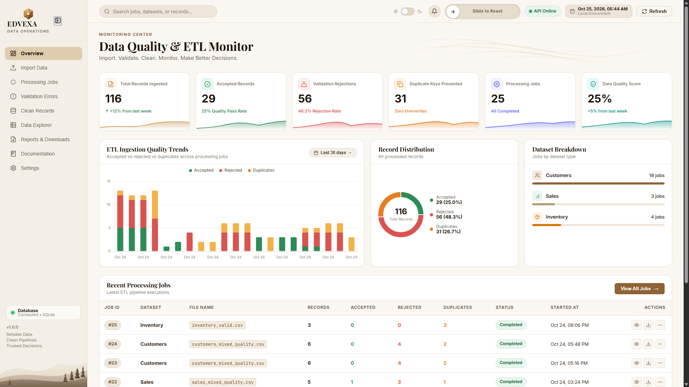
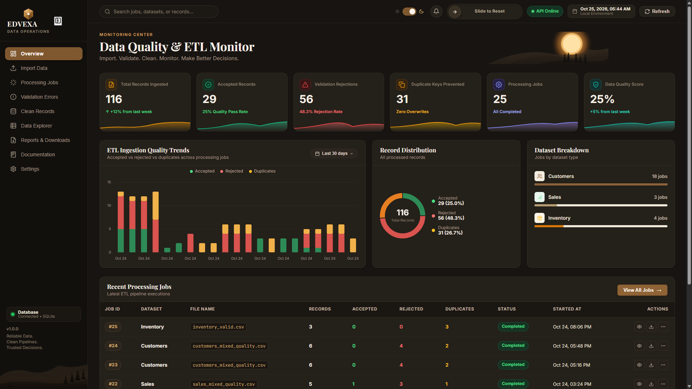
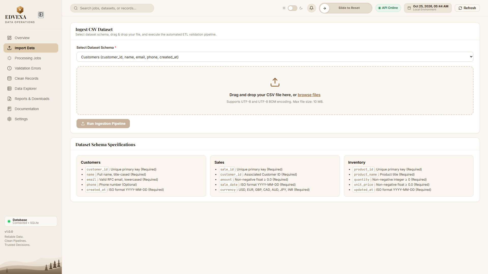
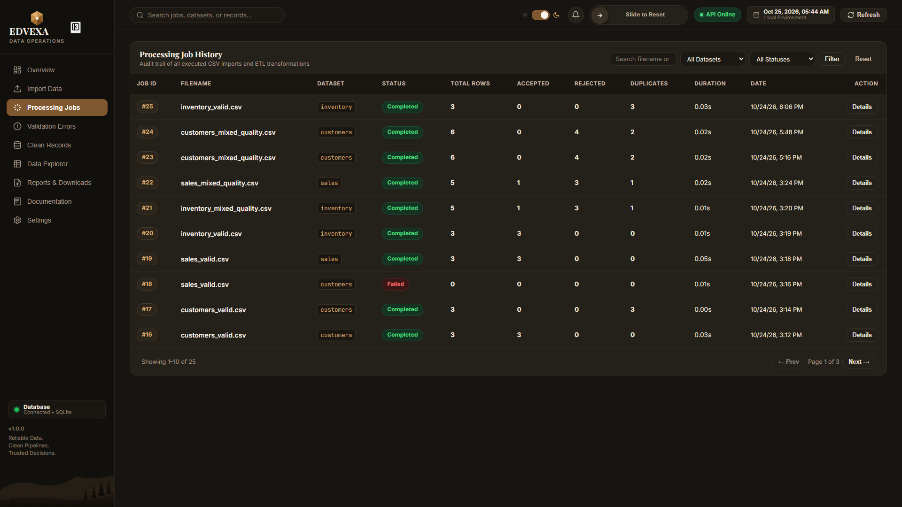
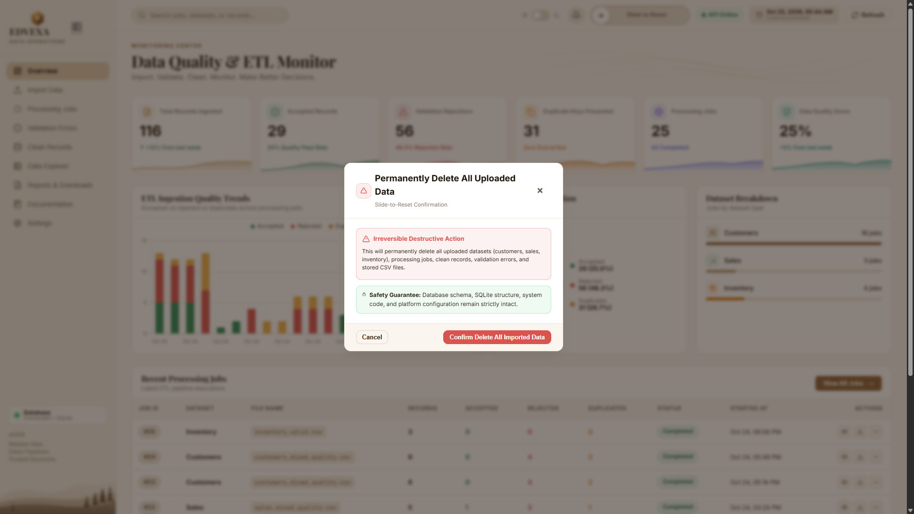
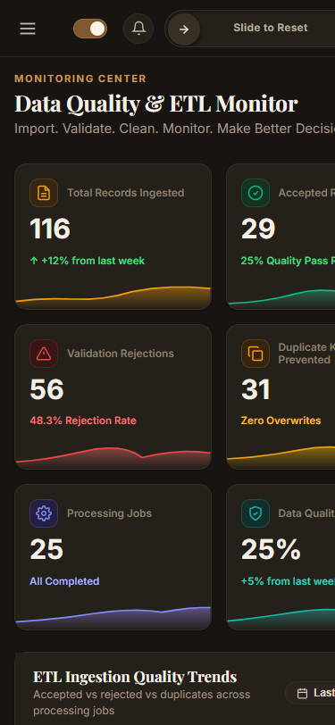

# Edvexa Data Quality & ETL Monitor

> **Subtitle:** Reliable Data. Clean Pipelines. Trusted Decisions.  
> **Author:** Raghav Kumar | Software Engineer  
> **Platform Version:** 2.7.0  
> **Live Production Application:** [https://edvexa-data-quality-etl-monitor.onrender.com](https://edvexa-data-quality-etl-monitor.onrender.com)  
> **Interactive Swagger API Docs:** [https://edvexa-data-quality-etl-monitor.onrender.com/docs](https://edvexa-data-quality-etl-monitor.onrender.com/docs)  
> **Live Health Verification:** [https://edvexa-data-quality-etl-monitor.onrender.com/api/health](https://edvexa-data-quality-etl-monitor.onrender.com/api/health)  
> **Video Walkthrough (Google Drive):** [Watch Demonstration Video (4m 23s)](https://drive.google.com/file/d/1HU3dQvIffSwfCqCI_qd0JEIJ-RBXtmij/view?usp=sharing)

---

## 1. Project Overview

**Edvexa Data Quality & ETL Monitor** is a production-grade web application and data quality observability engine designed to ingest, validate, sanitize, and load operational CSV datasets (Customers, Sales, and Inventory) into a relational database.

The platform guarantees strict data integrity before raw records can enter downstream clean storage tables. Every ingested row is accounted for deterministically under the fundamental invariant:

**Row accounting rule:** Total rows = accepted rows + rejected rows + duplicate rows + skipped rows.

The application provides multi-encoding CSV parsing, automated field normalization, duplicate prevention, an interactive dashboard with real-time quality metrics and historical trends, downloadable audit workbooks (CSV and Excel `.xlsx`), and a safe two-step slide-to-reset interaction.

---

## 2. Main Features

- **Multi-Format CSV Ingestion:** Automatic charset detection (UTF-8, UTF-8 with BOM, ISO-8859-1/Latin-1) with a 10 MB upload guardrail and structural header validation.
- **Granular Field Validation:** Standardized RFC 5322 email validation, calendar date verification (correctly rejecting non-leap year February 29th), whitespace stripping, title capitalization, numeric bounds checking, and ISO currency code enforcement.
- **Deduplication & Idempotency:** Distinguishes in-file duplicate keys (`DUPLICATE_KEY_IN_FILE`) from pre-existing database duplicates (`DUPLICATE_KEY_IN_DB`), backed by SHA-256 file hashing so repeated uploads never create duplicate records.
- **Interactive Observability Dashboard:** Real-time KPI summary cards, historical ingestion quality trend charts (Chart.js), dataset breakdowns, paginated job history, validation error reports, and a clean records browser.
- **Synchronized Date-Range Filtering:** Synchronized date filtering across dashboard summary, trend charts, jobs, clean records, and validation errors with strict empty-state displays.
- **Export & Download Engine:** Direct job-scoped downloads for Clean Records (CSV), Validation Errors (CSV), and comprehensive Job Audit Workbooks in Microsoft Excel format (`.xlsx`).
- **Two-Step Slide-to-Reset:** A physical slider gesture unlocks a confirmation checkbox; ticking the checkbox enables the "Permanently Delete" button; clicking the button permanently deletes uploaded records while strictly preserving database schemas, followed by an automatic full website reload.
- **Dual Themes & Accessibility:** Warm Ivory default theme and Dark Espresso mode with audited WCAG AA 4.5:1 text contrast across all form controls, drop zones, and data tables.
- **Interactive OpenAPI Documentation:** Fully typed Swagger UI (`/docs`) and ReDoc (`/redoc`) endpoints.

---

## 3. Live Demo and Screenshots

### Live Links
- **Live Application:** [https://edvexa-data-quality-etl-monitor.onrender.com](https://edvexa-data-quality-etl-monitor.onrender.com)
- **Interactive Swagger Docs:** [https://edvexa-data-quality-etl-monitor.onrender.com/docs](https://edvexa-data-quality-etl-monitor.onrender.com/docs)
- **Health Endpoint:** [https://edvexa-data-quality-etl-monitor.onrender.com/api/health](https://edvexa-data-quality-etl-monitor.onrender.com/api/health)
- **Demonstration Video Walkthrough:** [Watch on Google Drive (4m 23s)](https://drive.google.com/file/d/1HU3dQvIffSwfCqCI_qd0JEIJ-RBXtmij/view?usp=sharing)  
  *(The uncompressed 250 MB video file `demo/edvexa-demo.mp4` exists locally and is excluded from Git to comply with GitHub's 100 MB per-file limit).*

### Screenshots Gallery

#### 1. Dashboard Overview — Light Theme (Warm Ivory)

*Real-time KPI summary cards, quality pass rate, distribution donut chart, and 14-day ingestion trendline.*

#### 2. Dashboard Overview — Dark Theme (Dark Espresso)

*WCAG AA-compliant dark espresso theme with 4.5:1 text contrast and high-contrast status tokens.*

#### 3. Data Ingestion & Drag-and-Drop Workflow

*Dataset selection, drag-and-drop CSV drop zone, schema rules guide, and instant pipeline execution.*

#### 4. Processing Job Audit & Job Details

*Comprehensive processing jobs audit log with status badges, row counts, durations, and modal actions.*

#### 5. Two-Step Slide-to-Reset Modal

*Compact slide-to-reset interaction control with secondary confirmation checkbox and transactional data cleanup.*

#### 6. Mobile Responsive Viewport (375x812 iPhone)

*Mobile layout with responsive slide-out navigation drawer, stacked KPI cards, and touch-friendly controls.*

---

## 4. Technologies Used

- **Application Framework:** Python 3.11+, FastAPI, Uvicorn (ASGI server)
- **Data Validation & Schemas:** Pydantic v2
- **Database & ORM:** SQLAlchemy 2.0 with connection pooling
  - **Local Development:** SQLite (`edvexa_data.db`)
  - **Production Deployment:** Neon Serverless PostgreSQL (`postgresql://...sslmode=require`)
- **File Storage Abstraction:**
  - **Local Development:** Local filesystem (`uploads_storage/`)
  - **Production Deployment:** Neon Object Storage (S3-compatible via `boto3`)
- **Reporting Engine:** openpyxl (multi-sheet `.xlsx` workbooks with CWE-1236 formula sanitization)
- **Frontend:** Vanilla JavaScript (ES6+), custom CSS3 design tokens, Chart.js
- **Testing & Quality Assurance:** pytest, pytest-asyncio, httpx, Playwright
- **Hosting & Infrastructure:** Render (Web Service), GitHub Actions / Git version control

---

## 5. Prerequisites

- **Operating System:** Windows 10/11, macOS, or Linux
- **Python:** Python 3.11, 3.12, or newer
- **Git:** Installed and available on your system `PATH`
- **Modern Web Browser:** Google Chrome, Microsoft Edge, Mozilla Firefox, or Apple Safari with JavaScript enabled

---

## 6. Simple Installation and Startup Instructions

Follow these step-by-step instructions to run the application locally on your computer.

### Step 1: Clone or Navigate to the Project Directory
```powershell
git clone https://github.com/renavaraghav/edvexa-data-quality-etl-monitor.git
cd edvexa-data-quality-etl-monitor
```

### Step 2: Create a Virtual Environment
```powershell
python -m venv .venv
```

### Step 3: Activate the Virtual Environment
- **Windows (PowerShell):**
  ```powershell
  .\.venv\Scripts\Activate.ps1
  ```
- **Windows (Command Prompt):**
  ```cmd
  .\.venv\Scripts\activate.bat
  ```
- **macOS / Linux:**
  ```bash
  source .venv/bin/activate
  ```

### Step 4: Install Dependencies
```powershell
pip install -r requirements.txt
```

### Step 5: Start the Application Server
Run Uvicorn from the project root:
```powershell
uvicorn app.main:app --host 127.0.0.1 --port 8010 --reload
```
*(On Windows, you can also double-click `start_server.bat` for one-click startup).*

Upon startup, the application automatically initializes the SQLite database tables.

### Step 6: Open the Dashboard
Open your web browser and navigate to:
- **Dashboard UI:** [http://127.0.0.1:8010](http://127.0.0.1:8010)
- **Interactive Swagger Docs:** [http://127.0.0.1:8010/docs](http://127.0.0.1:8010/docs)
- **Health Verification:** [http://127.0.0.1:8010/api/health](http://127.0.0.1:8010/api/health)

---

## 7. How to Upload Sample CSV Files

Synthetic sample datasets are provided in the `sample_data/` directory.

### Upload Steps
1. Open the dashboard at [http://127.0.0.1:8010](http://127.0.0.1:8010).
2. Click **Import Data** in the left sidebar navigation.
3. Select the dataset type (**Customers**, **Sales**, or **Inventory**) from the dropdown.
4. Drag and drop a sample CSV file into the designated drop zone (or click to browse).
5. Click **Run Ingestion Pipeline**.
6. The feedback card immediately displays the results: accepted records, rejected records, and duplicate keys prevented.

### Catalog of Sample Datasets (`sample_data/`)

| Filename | Dataset Type | Records | Purpose & Scenarios Tested |
| :--- | :--- | :--- | :--- |
| `customers_valid.csv` | Customers | 5 | Clean records; tests whitespace normalization, email lowercasing, and date parsing. |
| `customers_invalid.csv` | Customers | 7 | Invalid records; tests malformed emails, non-leap year Feb 29 dates (`2023-02-29`), and missing fields. |
| `customers_duplicates.csv` | Customers | 2 | In-file duplicate primary key (`CUST-001`). Row 1 is accepted, Row 2 is flagged as duplicate. |
| `sales_valid.csv` | Sales | 5 | Clean sales transactions with valid amounts, dates, and ISO currency codes (`USD, EUR, GBP, JPY`). |
| `sales_invalid.csv` | Sales | 6 | Invalid sales; tests negative amounts (`-150.00`), unsupported currencies (`BITCOIN`), and bad dates. |
| `inventory_valid.csv` | Inventory | 5 | Clean products with valid integer quantities and unit prices. |
| `inventory_invalid.csv` | Inventory | 6 | Invalid inventory; tests negative stock (`-5`), fractional counts (`12.75`), and blank names. |
| `customers.csv` | Customers | 13 | Comprehensive mixed dataset testing clean records, duplicates, and errors in a single file. |
| `sales.csv` | Sales | 12 | Comprehensive mixed sales dataset with negative amounts, currency, and date boundary checks. |
| `inventory.csv` | Inventory | 12 | Comprehensive mixed inventory dataset testing negative stock, decimal quantities, and blank names. |

---

## 8. Viewing Records, Errors, Jobs, and Exporting Reports

The left sidebar gives you instant access to all observability sections:

### 1. View Accepted Records
- Click **Clean Records** in the sidebar.
- Switch between **Customers**, **Sales**, and **Inventory** tabs.
- Clean records display normalized formatting: names in Title Case, trimmed whitespace, lowercase emails, and standardized `YYYY-MM-DD` dates.

### 2. View Rejected Records & Validation Errors
- Click **Validation Errors** in the sidebar.
- The table displays exact CSV row numbers, dataset types, field names, error codes (e.g., `INVALID_EMAIL_FORMAT`, `MISSING_REQUIRED_FIELD`), human-readable error messages, and original invalid values.

### 3. Review Processing Jobs & Download Reports
- Click **Processing Jobs** in the sidebar.
- Each job displays the original filename, dataset type, status badge, row breakdown, SHA-256 checksum, and processing duration.
- Click **Details** on any job to open the Job Details modal:
  - **Clean Records (CSV):** Downloads accepted records for that specific job. (Disabled if 0 clean records).
  - **Validation Errors (CSV):** Downloads validation error diagnostics for that job. (Disabled if 0 errors).
  - **Download Excel Report (.xlsx):** Downloads a 3-sheet Microsoft Excel workbook containing:
    1. *Job Summary:* Job metadata, row counts, and mathematical reconciliation audit.
    2. *Clean Records:* Formatted table of accepted rows with auto-filters.
    3. *Validation Errors:* Formatted table of rejected rows with failure reasons.

### 4. Overview Metrics & Trend Charts
- Click **Overview** in the sidebar.
- Live KPI cards display: Total Records Processed, Accepted Clean Records, Rejected Records, Duplicate Records, Total Processing Jobs, and Data Quality Pass Rate.
- Trend percentages compare current metrics against previous periods when genuine historical data exists. When prior data is not available, the dashboard clearly displays *"No previous-period comparison available"* with an explanatory tooltip.

---

## 9. How to Run Tests

The test suite runs against an isolated, in-memory SQLite database (`sqlite:///:memory:`) so your operational database is never modified.

### Run the Full Test Suite
```powershell
pytest -v
```

### Verified Test Results (Executed October 26, 2026)
- **Command:** `.venv\Scripts\pytest -v`
- **Items Collected:** 99
- **Passed:** **99**
- **Failed:** **0**
- **Skipped:** **0**
- **Warnings:** **17** *(library deprecation notices in FastAPI/Starlette testclient)*
- **Execution Time:** ~48 seconds

```text
============================= test session starts =============================
platform win32 -- Python 3.12.5, pytest-9.1.1, pluggy-1.7.0
rootdir: C:\Users\rjha1\Downloads\csv_project
collected 99 items

tests/test_api.py ........................                               [ 24%]
tests/test_dashboard_upgrade.py ..                                      [ 26%]
tests/test_deployment_storage_and_security.py .....................      [ 47%]
tests/test_etl.py .........                                              [ 56%]
tests/test_playwright_reset_flow.py ......                               [ 62%]
tests/test_public_reset_and_safety.py .......                            [ 69%]
tests/test_reset_and_filter.py ...........                               [ 80%]
tests/test_transformation.py .......                                     [ 87%]
tests/test_validation.py .............                                   [100%]

====================== 99 passed, 17 warnings in 48.52s =======================
```

---

## 10. Important REST API Endpoints

All endpoints return standard JSON responses and status codes. Interactive documentation is available at [http://127.0.0.1:8010/docs](http://127.0.0.1:8010/docs).

| Method | Endpoint | Description |
| :--- | :--- | :--- |
| `GET` | `/api/health` | Health probe returning status, app version, database dialect, and storage backend. |
| `POST` | `/api/uploads` | Multipart CSV upload endpoint with `dataset_type` query parameter (`customers`, `sales`, `inventory`). |
| `GET` | `/api/jobs` | Paginated list of processing jobs with filtering by dataset and date range. |
| `GET` | `/api/jobs/{id}` | Detailed execution metadata, error itemization, and row counts for a specific job. |
| `POST` | `/api/jobs/{id}/reprocess` | Reprocesses a previously uploaded CSV file using stored file artifacts. |
| `GET` | `/api/jobs/{id}/download/clean` | Exports accepted records for a specific job as a CSV file. |
| `GET` | `/api/jobs/{id}/download/errors` | Exports validation errors for a specific job as a CSV file. |
| `GET` | `/api/jobs/{id}/download/summary` | Exports a multi-sheet Microsoft Excel report (`.xlsx`) for a specific job. |
| `GET` | `/api/records` | Paginated browser for clean stored records by dataset type (`customers`, `sales`, `inventory`). |
| `GET` | `/api/errors` | Paginated listing of validation errors across all jobs with filtering options. |
| `GET` | `/api/dashboard/summary` | Real-time aggregate KPIs, dataset metrics, quality score, and trend calculations. |
| `GET` | `/api/dashboard/trends` | Daily/job-level ingestion trends for Chart.js visualization. |
| `GET` | `/api/dashboard/reset-status` | Reports whether destructive data reset is enabled and policy status. |
| `POST` | `/api/dashboard/reset-data` | Destructive reset endpoint clearing all uploaded data while preserving database schema. |
| `POST` | `/api/dashboard/reset-preferences` | Resets client UI view preferences, filters, and theme. |

### Example `curl` Commands

```powershell
# Check System Health:
curl.exe -s http://127.0.0.1:8010/api/health

# Upload a Customers CSV file:
curl.exe -X POST "http://127.0.0.1:8010/api/uploads?dataset_type=customers" -F "file=@sample_data/customers_valid.csv"

# Fetch Dashboard Summary KPIs:
curl.exe -s http://127.0.0.1:8010/api/dashboard/summary

# Download Excel Job Audit Report:
curl.exe -O -J "http://127.0.0.1:8010/api/jobs/1/download/summary"
```

---

## 11. Database Setup, Environment Configuration & Reset Safety

### Database Architecture
- **Local Development:** The application uses SQLite (`edvexa_data.db`) located in the project root. The schema initializes automatically on first run; no external database server is needed.
- **Production Deployment:** The live application on Render connects to Neon Serverless PostgreSQL (`ep-lingering-meadow-a50j79j9.us-east-2.aws.neon.tech`). Connections automatically enforce SSL (`sslmode=require`) and connection pooling.
- **File Storage:** Uploaded CSV files are saved to `uploads_storage/` locally, and to Neon Object Storage (S3-compatible) in production.

### Environment Variables Reference

| Variable | Required | Default | Description |
| :--- | :--- | :--- | :--- |
| `ENVIRONMENT` | Yes | `development` | Runtime environment (`development` or `production`). |
| `DATABASE_URL` | Yes | `sqlite:///./edvexa_data.db` | Database connection string. Supports SQLite and PostgreSQL with SSL. |
| `STORAGE_BACKEND` | Optional | `local` | `local` for filesystem storage or `neon` for Neon Object Storage. |
| `FORCE_DISABLE_DESTRUCTIVE_RESET` | Optional | `false` | Set to `true` to disable the destructive reset endpoint. When unset or `false`, reset remains enabled in the assignment demo configuration. |
| `CORS_ORIGINS` | Optional | `*` | Comma-delimited list of permitted CORS origins. |
| `UPLOAD_MAX_SIZE_BYTES` | Optional | `10485760` | Maximum file upload payload size (10 MB). |

### Two-Step Destructive Data Reset
The platform includes an iPhone-style Slide-to-Reset control to clear uploaded data without dropping database tables:

1. **Slide to Unlock:** The user drags the slider thumb past 85% of track width to the end.
2. **Confirmation Checkbox:** Reaching the end opens the confirmation modal and unlocks the confirmation checkbox (*"I understand that this action will permanently delete the selected uploaded data and associated processing history."*).
3. **Button Activation:** Ticking the checkbox enables the red **"Permanently Delete"** button. Ticking the box alone never deletes data.
4. **Explicit Execution:** Deletion happens only when the user explicitly clicks the enabled **"Permanently Delete"** button.
5. **Atomic Purge & Automatic Refresh:** The backend purges records inside an atomic transaction, unlinks uploaded files, and confirms success. The frontend then executes `window.location.reload()`, performing an automatic full page refresh so all dashboard numbers and tables display the fresh updated state.

> [!NOTE]
> **Assignment Demo Configuration:**  
> The app computes its internal `ALLOW_DESTRUCTIVE_RESET` setting from `FORCE_DISABLE_DESTRUCTIVE_RESET`. In the current assignment-demo configuration, `FORCE_DISABLE_DESTRUCTIVE_RESET` is unset or `false`, so reset is enabled without an administrative token or login.  
> Direct API requests to `POST /api/dashboard/reset-data` bypass the frontend slider and checkbox controls because backend token enforcement is disabled in this evaluation mode. The separate module at `app/routers/auth.py` is not wired to this reset endpoint in the current demo, so it does not protect this route.

---

## 12. Project Folder Structure

```
edvexa-data-quality/
├── app/
│   ├── main.py                     # FastAPI application factory, middleware & route registration
│   ├── config.py                   # Pydantic settings, environment variables & DB URL normalization
│   ├── database.py                 # SQLAlchemy engine, session maker & schema initialization
│   ├── models.py                   # SQLAlchemy 2.0 ORM models (Jobs, Errors, Clean Tables)
│   ├── schemas.py                  # Pydantic validation models & response serialization
│   ├── services/
│   │   ├── csv_import.py           # Multi-encoding file parsing & header verification
│   │   ├── transformation.py       # Deterministic cleaning, casing, date & numeric normalizers
│   │   ├── validation.py           # Schema rules, email regex, bounds checks & error generation
│   │   ├── etl_pipeline.py         # Atomic ETL execution, transaction management & idempotency
│   │   ├── export_service.py       # Job-scoped CSV & multi-sheet Excel (.xlsx) export generator
│   │   ├── storage.py              # Storage abstraction (Local filesystem & Neon Object Storage S3)
│   │   └── auth.py                 # Password hashing & session-based authentication service
│   ├── routers/
│   │   ├── uploads.py              # POST /api/uploads multipart CSV endpoint
│   │   ├── jobs.py                 # Processing jobs listing, details & reprocess endpoints
│   │   ├── errors.py               # Validation errors listing & CSV export endpoints
│   │   ├── records.py              # Clean records browser (Customers, Sales, Inventory)
│   │   ├── dashboard.py            # Summary KPIs, trends, reset-status & reset-data
│   │   └── auth.py                 # Admin login, logout & session status endpoints
│   ├── templates/
│   │   └── index.html              # Responsive SPA layout (Sidebar, Overview, Ingestion, Tables)
│   └── static/
│       ├── css/styles.css          # Design tokens, Warm Ivory theme, Dark Espresso mode
│       └── js/app.js               # SPA navigation, modals, upload dropzone, Chart.js & slider
│
├── sample_data/                    # 10 synthetic test CSV datasets (valid, invalid, duplicates, mixed)
├── screenshots/                    # 6 high-resolution application screenshots
├── demo/
│   ├── README.md                   # Video walkthrough documentation & streaming link
│   └── edvexa-demo.mp4             # 4m 23s demonstration video (local file, gitignored)
├── tests/                          # 99 automated tests covering API, ETL, validation, reset, and storage
├── schema.sql                      # Standalone ANSI SQL DDL schema definitions & indexes
├── requirements.txt                # Pinned dependencies
├── render.yaml                     # Render Blueprint infrastructure specification
├── TECHNICAL_NOTES.md              # In-depth architectural notes & trade-offs
├── TECHNICAL_NOTES.pdf             # Publication-grade printable technical documentation
├── DEMO_CHECKLIST.md               # 14-step evaluator verification sequence
└── README.md                       # This comprehensive operational guide
```

---

## 13. Known Limitations and Troubleshooting

### Known Limitations
1. **Synchronous Ingestion:** File uploads are processed synchronously within the request lifecycle. This is fast and deterministic for files under 10 MB. In high-volume enterprise pipelines, processing would be offloaded to an asynchronous background worker (e.g., Celery + Redis).
2. **Public Reset in Demo Mode:** To allow evaluators to test data reset without credentials, destructive reset is currently open in production. Setting `FORCE_DISABLE_DESTRUCTIVE_RESET=true` disables the reset endpoint.

### Common Troubleshooting Tips
- **Port 8010 Already in Use:**
  Run the server on a different port:
  ```powershell
  uvicorn app.main:app --port 8080 --reload
  ```
- **PowerShell Script Execution Policy Error:**
  If activating `.venv\Scripts\Activate.ps1` produces a script execution restriction warning:
  ```powershell
  Set-ExecutionPolicy -ExecutionPolicy RemoteSigned -Scope CurrentUser
  ```
- **Resetting the Local Database Manually:**
  To start with a fresh empty database:
  ```powershell
  Remove-Item edvexa_data.db -ErrorAction SilentlyContinue
  Remove-Item uploads_storage\*.csv -ErrorAction SilentlyContinue
  ```
  Restarting the server recreates fresh empty tables automatically.

---

## 14. Technical Notes, Demo Video, and Credits

### Technical Documentation
Detailed engineering architecture notes, data models, trade-offs, and tooling demarcations are published in both Markdown and printable PDF formats:
- 📄 [Read Technical Notes (Markdown)](TECHNICAL_NOTES.md)
- 📑 [Download Technical Notes (PDF)](TECHNICAL_NOTES.pdf)

### Demonstration Video
- **Online Stream (Google Drive):** [Watch EDVEXA Video Walkthrough (4m 23s)](https://drive.google.com/file/d/1HU3dQvIffSwfCqCI_qd0JEIJ-RBXtmij/view?usp=sharing)
- **Local File:** `demo/edvexa-demo.mp4` *(249.86 MB, preserved locally)*

### Credits & Development Tools

- **Author:** Raghav Kumar
- **Project:** Edvexa Data Quality & ETL Monitoring Platform

**CodeZero:** Used during initial exploration of the starter materials to inspect the standalone `csv_quality_checker.py` exercise, analyze baseline data-validation requirements, and plan the initial architecture and README structure. That exercise file is not part of the final web-app repository; the documented CodeZero contribution was exploration and planning.

**Review and verification:** The implementation was checked against the assignment requirements, and development notes record manual refinements for UTF-8 BOM parsing, strict calendar-date validation, row numbering, idempotent reprocessing, and spreadsheet formula-injection mitigation. The current documented local test run reports 99 passed tests and 17 library deprecation warnings.

**Google Antigravity:** Assisted with subsequent full-stack implementation, including FastAPI endpoints, SQLAlchemy models, ETL processing, the dashboard, reporting, and automated tests.

For the detailed architecture, challenges, development workflow, and tool contributions, see [Technical Notes](TECHNICAL_NOTES.md).
